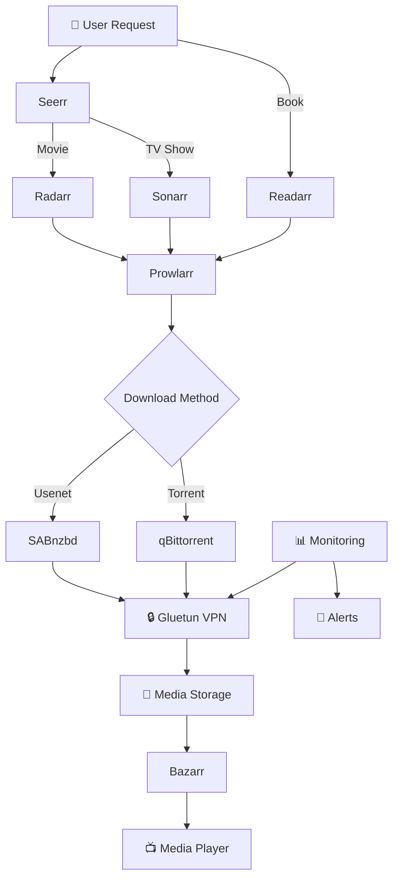

# Complete Media Automation Stack for Synology NAS

[](https://opensource.org/licenses/MIT)

> A fully automated media server stack running on Synology NAS with Docker. Features the complete *arr ecosystem (Radarr, Sonarr, Bazarr, Prowlarr, Readarr), download clients (SABnzbd, qBittorrent), media requests (Seerr), automated VPN monitoring with Gluetun — plus TRaSH-guides syncing (Recyclarr), disk-space reclamation, a status dashboard, and an MCP server for LLM-driven management.
>
> What sets this stack apart from the many similar ones: **API-driven WireGuard automation for Privado VPN** (auto-rotation and recovery when the provider silently rotates server configs) and a **space-saver system** that automatically replaces oversized remuxes with efficient encodes ([docs/space-saver.md](docs/space-saver.md)).

## 🎯 What This Provides

A complete, production-ready media automation system that:

- 🎬 **Automatically downloads** movies, TV shows, books, and subtitles
- 🔒 **Protects all traffic** through VPN with automatic monitoring
- 📱 **Simple requests** via beautiful web interface (Seerr)
- 🔍 **Smart indexer management** across multiple providers
- 📊 **Full monitoring** with alerts for any issues
- 🔄 **Zero maintenance** - handles VPN changes, updates, failures automatically
- 🏠 **Synology optimized** - designed specifically for Synology NAS

## 📦 Services Overview

| Service | Purpose | Port | Web UI | VPN Protected |
|---------|---------|------|---------|---------------|
| **Gluetun** | VPN Gateway | 8005 | control API | N/A |
| **SABnzbd** | Usenet Downloads | 8080 | ✅ | ✅ |
| **qBittorrent** | Torrent Downloads | 8090 | ✅ | ✅ |
| **Radarr** | Movie Management | 7878 | ✅ | ❌ |
| **Sonarr** | TV Show Management | 8989 | ✅ | ❌ |
| **Bazarr** | Subtitle Management | 6767 | ✅ | ❌ |
| **Prowlarr** | Indexer Management | 9696 | ✅ | ❌ |
| **Seerr** | Media Requests | 5055 | ✅ | ❌ |
| **Readarr** | Book Management | 8787 | ✅ | ❌ |
| **Recyclarr** | Daily TRaSH-guides sync | — | — | ❌ |
| **Scoutarr** | Batch upgrade searches | 5839 | ✅ | ❌ |
| **Cleanuparr** | Stalled-download cleanup | 11011 | ✅ | ❌ |
| **MCP Server** | LLM integration ([mcp-mediastack](https://github.com/aderaaij/mcp-mediastack)) | 8888 | — | ❌ |
| **Dashboard** | Status overview ([mediastack-dashboard](https://github.com/aderaaij/mediastack-dashboard)) | 8899 | ✅ | ❌ |

## 🏗️ Media Automation Flow



## 🚀 Quick Start

### 1. Clone and Setup
```bash
git clone https://github.com/aderaaij/privateer-watch.git
cd privateer-watch

# Copy environment template and edit with your values
cp .env.example .env

# Edit .env with your actual values (adjust path if needed)
nano .env
```

### 2. Start the Stack
```bash
docker-compose up -d
```

### 3. Install Monitoring Scripts
```bash
sudo bash scripts/setup_monitoring.sh
```

### 4. Configure DSM Task Scheduler
1. Open **Control Panel → Task Scheduler**
2. Create scheduled tasks (run as root):
   - **VPN Health Monitor**: Every 30 minutes - `${DOCKERCONFDIR}/scripts/task_monitor.sh`
   - **Config Update Check**: Daily - `${DOCKERCONFDIR}/scripts/task_update.sh`
   - **Container Updates** (optional): Daily - `${DOCKERCONFDIR}/scripts/pullio_with_recovery.sh`
   - **Off-box Backup** (optional): Nightly - `${DOCKERCONFDIR}/scripts/backup_offbox.sh` (run `setup_offbox_backup.sh` once first)

That's it! Your VPN monitoring is now active. The monitor auto-restarts a failed VPN and rotates to a fresh Privado server after repeated failures.

## 🔌 Adapting to Your Setup

Everything host-specific lives in `.env` — no tracked file should need editing:

- **`NAS_HOST`** — your NAS's LAN IP; the MCP server and dashboard use it to reach the other services.
- **`DOCKERCONFDIR` / `DOCKERSTORAGEDIR`** — config and media paths (`/volume1/...` on Synology).
- **`RADARR_URL` / `SONARR_URL`** — optional; defaults use Docker container-name DNS.
- **`BACKUP_REMOTE_*`** — optional; only needed for off-box backups.

Synology assumptions worth knowing if you run something else: the compose file uses a user-defined bridge network named `synobridge` (`docker network create synobridge`, or rename it), scheduling uses DSM Task Scheduler (swap for cron), and the VPN automation is Privado-specific — any other WireGuard provider works via the manual config flow (`wireguard_configs/` + `parse_wireguard_conf.sh`).

## 📋 Features

### 🎬 Media Management
- **Automated Downloads** - Movies, TV shows, books download automatically
- **Quality Profiles** - Custom quality settings for different media types
- **Release Monitoring** - Automatically grabs new episodes and movies
- **Metadata Management** - Posters, descriptions, ratings automatically added
- **Library Organization** - Consistent naming and folder structure
- **Subtitle Management** - Automatic subtitle downloads in multiple languages

### 🔍 Content Discovery & Requests
- **Beautiful Request Interface** - Users can easily request new content
- **Trending Content** - Discover what's popular across services
- **Advanced Search** - Find content across all configured indexers
- **User Management** - Control who can request what content
- **Request Approval** - Optional approval workflow for requests

### 📥 Download Management  
- **Multi-Source Downloads** - Both Usenet (SABnzbd) and Torrents (qBittorrent)
- **Intelligent Grabbing** - Best release selection based on your preferences
- **Failed Download Handling** - Automatic retry with different releases
- **Download Prioritization** - Control download order and speed limits
- **Category Management** - Organize downloads by type and priority

### 🔒 VPN & Security Features
- **Full VPN Protection** - All download traffic routed through VPN
- **Automatic VPN Monitoring** - Detects and fixes VPN failures instantly
- **Server Rotation** - Automatic VPN server switching for optimal performance
- **Kill Switch Protection** - Downloads stop if VPN fails
- **API-Based Configuration** - Automatic VPN config updates from provider
- **Smart Server Selection** - Choose best servers by location and performance

### 📊 Monitoring & Automation
- **Health Monitoring** - All services monitored with automatic recovery
- **Discord Notifications** - Real-time alerts for issues and completions
- **Performance Tracking** - Monitor download speeds and VPN performance
- **Automated Updates** - Container updates with Pullio integration
- **Log Management** - Centralized logging with rotation
- **Status Dashboard** - Single-pane web UI (port 8899): VPN tunnel, storage, queues, service health, upcoming calendar
- **MCP Server** - Manage the whole stack conversationally from Claude: status, queues, adding media, approving requests (see [mcp-mediastack](https://github.com/aderaaij/mcp-mediastack) for setup)

### 💾 Disk-Space Reclamation (Space-Saver)
- **Automatic downgrades** - Oversized remuxes/2160p files are replaced by high-quality efficient encodes via penalty custom formats
- **TRaSH-guides scoring** - Recyclarr syncs quality profiles daily so smaller never means junk
- **Batch sweeps** - Scoutarr triggers the upgrade searches library-wide
- **Dead-download cleanup** - Cleanuparr strikes out stalled grabs and triggers re-searches
- See [docs/space-saver.md](docs/space-saver.md) for the full design

## 📁 Project Structure

```
├── docker-compose.yml            # Complete stack: *arrs, Gluetun, extras
├── .env.example                  # Configuration template (single source of host-specific values)
├── recyclarr/
│   └── recyclarr.yml             # TRaSH-guides sync config + space-saver profiles
├── scripts/
│   ├── lib/common.sh             # Shared helpers (paths, .env, notifications, compose v1/v2)
│   ├── wireguard_monitor.sh      # Main monitoring (runs every 30min)
│   ├── auto_update_wireguard.sh  # Automated server rotation & selection
│   ├── restart_vpn_stack.sh      # Canonical gluetun + dependents restart
│   ├── check_vpn.sh              # Manual status check
│   ├── parse_wireguard_conf.sh   # Interactive config updater
│   ├── update_wireguard.sh       # Automated config checker
│   ├── setup_monitoring.sh       # One-time installation
│   ├── setup_space_saver_profiles.sh # Penalty CFs for the space-saver system
│   ├── backup_offbox.sh          # Nightly .env + *arr backup shipping
│   ├── setup_offbox_backup.sh    # One-time SSH key setup for backups
│   ├── pullio_with_recovery.sh   # Container updates + gluetun-dependent recovery
│   ├── task_monitor.sh           # DSM task wrapper (monitor)
│   ├── task_update.sh            # DSM task wrapper (update)
│   └── privado-api/              # Privado VPN API integration
│       ├── privado_login.sh      # Authenticate with Privado API
│       ├── privado_get_servers.sh # Fetch server list
│       ├── privado_generate_config.sh # Generate WG config
│       └── ...                   # Helpers (login, server resolution, templating)
└── docs/
    ├── synology-setup.md         # Detailed setup instructions
    ├── automation-features.md    # VPN automation deep-dive
    ├── space-saver.md            # Disk-space reclamation design
    ├── pullio-setup.md           # Container auto-update setup
    └── discord-webhook-setup.md  # Notification setup
```

## 🌐 Quick Access URLs

After setup, access your services at these URLs (replace `your-synology-ip`):

| Service | URL | Purpose |
|---------|-----|---------|
| **Seerr** | `http://your-synology-ip:5055` | 📱 Request movies, TV shows, books |
| **Radarr** | `http://your-synology-ip:7878` | 🎬 Manage movies |
| **Sonarr** | `http://your-synology-ip:8989` | 📺 Manage TV shows |
| **Readarr** | `http://your-synology-ip:8787` | 📚 Manage books |
| **Bazarr** | `http://your-synology-ip:6767` | 📄 Manage subtitles |
| **Prowlarr** | `http://your-synology-ip:9696` | 🔍 Manage indexers |
| **SABnzbd** | `http://your-synology-ip:8080` | ⬇️ Usenet downloads |
| **qBittorrent** | `http://your-synology-ip:8090` | ⬇️ Torrent downloads |
| **Gluetun** | `http://your-synology-ip:8005` | 🔒 VPN status & control |
| **Dashboard** | `http://your-synology-ip:8899` | 📊 Whole-stack status overview |
| **Scoutarr** | `http://your-synology-ip:5839` | 🔁 Batch upgrade searches |
| **Cleanuparr** | `http://your-synology-ip:11011` | 🧹 Stalled-download cleanup |

## 🛠️ Usage

### Check System Status
```bash
# Quick status check with colored output
bash ${DOCKERCONFDIR}/scripts/check_vpn.sh
```

### Media Management

**Request New Content:**
1. Open Seerr at `http://your-synology-ip:5055`
2. Search for movies or TV shows (books are managed directly in Readarr)
3. Click "Request" - it will automatically be added to the appropriate *arr service
4. Downloads start automatically when available

**Monitor Downloads:**
- **SABnzbd**: `http://your-synology-ip:8080` - Usenet downloads
- **qBittorrent**: `http://your-synology-ip:8090` - Torrent downloads
- Check that VPN is active (should show VPN IP, not your real IP)

### VPN Configuration Management
When your VPN provider updates their config:

1. **Download** new .conf from your VPN provider
2. **Place** it in `${DOCKERCONFDIR}/wireguard_configs/`
3. **Run** the updater:
   ```bash
   sudo bash ${DOCKERCONFDIR}/scripts/parse_wireguard_conf.sh
   ```
4. **Review** the changes and confirm
5. **Done!** - Scripts handle backup, update, and restart

### 🆕 Automated Server Management
```bash
# Force immediate server rotation (uses preferences)
sudo ${DOCKERCONFDIR}/scripts/auto_update_wireguard.sh force

# Switch to specific location
sudo ${DOCKERCONFDIR}/scripts/auto_update_wireguard.sh Amsterdam
sudo ${DOCKERCONFDIR}/scripts/auto_update_wireguard.sh NL
sudo ${DOCKERCONFDIR}/scripts/auto_update_wireguard.sh Portugal

# Automatic rotation (only if enabled and scheduled)
sudo ${DOCKERCONFDIR}/scripts/auto_update_wireguard.sh auto
```

### View Logs
```bash
# Monitor log (real-time)
tail -f ${DOCKERCONFDIR}/logs/wireguard_monitor.log

# Update log
tail -f ${DOCKERCONFDIR}/logs/wireguard_updates.log
```

## ⚙️ Configuration

### Environment Variables (.env)
Key settings managed by the scripts:

```bash
# Base Configuration
DOCKERCONFDIR="/path/to/your/stack"        # Configurable base directory
```

Key WireGuard settings:
```bash
# Basic WireGuard Configuration
WIREGUARD_ENDPOINT_IP="203.0.113.10"      # VPN server IP
WIREGUARD_ENDPOINT_PORT="51820"           # VPN server port  
WIREGUARD_PUBLIC_KEY="server_public_key"  # Server public key
WIREGUARD_PRIVATE_KEY="your_private_key"  # Your private key
WIREGUARD_ADDRESSES="10.0.0.2/32"         # Your VPN IP

# 🆕 Automation Settings
WIREGUARD_PREFERRED_COUNTRIES="PT,NL,DE,UK,FR"        # Preferred countries
WIREGUARD_PREFERRED_CITIES="Lisbon,Amsterdam,Berlin"   # Preferred cities
WIREGUARD_AUTO_ROTATION="true"                        # Enable auto rotation
WIREGUARD_ROTATION_INTERVAL="24"                      # Hours between rotations
WIREGUARD_MAX_LATENCY="150"                          # Max latency (ms)

# VPN Provider Credentials (for API access)
PRIVADO_USERNAME="your_username"
PRIVADO_PASSWORD="your_password"
```

> **🔒 Security Note**: The `.env` file contains sensitive credentials and is excluded from git. Use `.env.example` as your template.

### Discord Notifications
Add your webhook URL to `.env`:
```bash
PULLIO_DISCORD_WEBHOOK=https://discord.com/api/webhooks/YOUR_WEBHOOK_URL
```

## 🔧 Troubleshooting

### VPN Connection Issues
```bash
# Check container status
docker logs gluetun --tail 50

# Test current IP
docker exec qbittorrent wget -qO- ifconfig.me

# Manual restart - ALWAYS use the restart script, never `docker-compose restart gluetun`:
# it doesn't re-read .env, and the download clients are pinned to gluetun's
# container ID (network_mode: service:gluetun) so they must be recreated together
sudo bash ${DOCKERCONFDIR}/scripts/restart_vpn_stack.sh
```

### Script Issues
```bash
# Check permissions
ls -la ${DOCKERCONFDIR}/scripts/

# Make executable
sudo chmod +x ${DOCKERCONFDIR}/scripts/*.sh
```

## 🏷️ Supported Services

**Download Sources:**
- ✅ Usenet (SABnzbd) - Primary recommendation for reliability
- ✅ Torrents (qBittorrent) - Backup and rare content

**VPN Providers:**
- ✅ Privado VPN - full API automation (server rotation, auto-recovery, config generation)
- ✅ Any WireGuard-compatible provider - via the manual config flow (`wireguard_configs/` + `parse_wireguard_conf.sh`); Gluetun also supports many providers natively

**Media Sources:**
- ✅ Movies, TV Shows, Documentaries
- ✅ Books (eBooks, Audiobooks)
- ✅ Subtitles in multiple languages

## 📊 Automation Schedule

- **Media Monitoring**: Continuous scanning for new releases
- **VPN Health Check**: Every 30 minutes with auto-recovery (rotates server after repeated failures)
- **Config Update Check**: Daily scan of `wireguard_configs/` for new provider configs
- **TRaSH-Guides Sync**: Daily quality-profile and custom-format sync via Recyclarr
- **Failed Download Retry**: Automatic retry with different releases; Cleanuparr strikes out dead grabs
- **Subtitle Downloads**: Automatic after media download completes
- **Container Updates**: Managed by Pullio with Discord notifications
- **Off-box Backups**: Nightly `.env` + *arr database backups shipped to another host (optional)

## 🤝 Contributing

Found a bug? Want to add a feature? Contributions welcome!

1. Fork the repository
2. Create a feature branch
3. Make your changes  
4. Test thoroughly
5. Submit a pull request

## 📝 License

This project is licensed under the MIT License - see the [LICENSE](LICENSE) file for details.

## 🙏 Acknowledgments

- [Gluetun](https://github.com/qdm12/gluetun) - Excellent VPN container
- [TRaSH Guides](https://trash-guides.info/) - Docker setup inspiration and quality profiles
- [Hotio](https://hotio.dev/) - High-quality container images for all *arr services
- [LinuxServer.io](https://linuxserver.io/) - Container expertise and documentation
- [Privado VPN](https://privadovpn.com/) - VPN provider with API support
- The entire *arr community for building amazing media automation tools

## ⭐ Star History

If this project helped you, please star it to help others discover it!

---

**Need help?** Check the [docs/synology-setup.md](docs/synology-setup.md) for detailed setup instructions or open an issue!